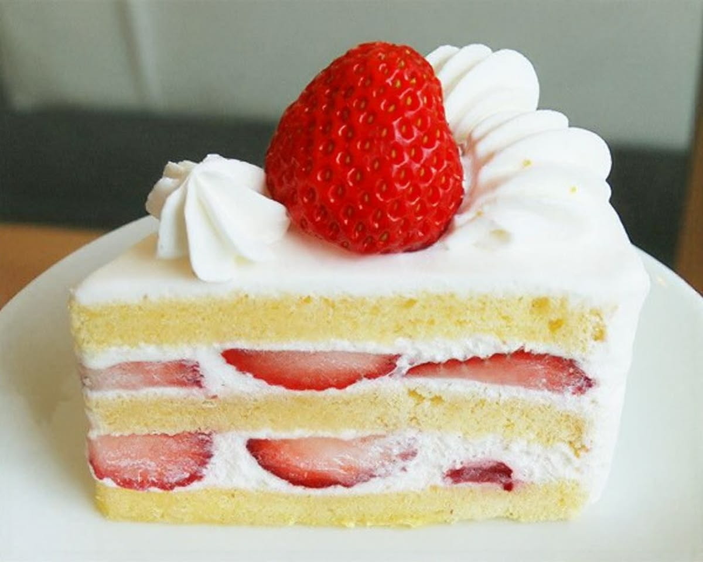
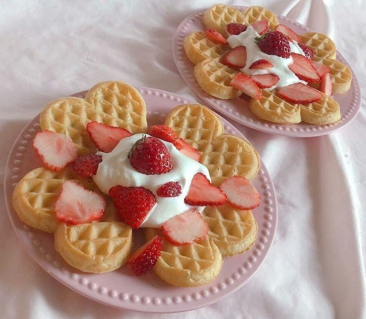
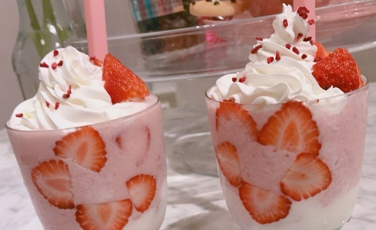

<!DOCTYPE html>
<html lang="en">
<head>
  <meta charset="UTF-8">
  <meta name="viewport" content="width=device-width, initial-scale=1.0">
  <title>Eve's Abode | A Little Picnic Cafe</title>
  <link rel="preconnect" href="https://fonts.googleapis.com">
  <link rel="preconnect" href="https://fonts.gstatic.com" crossorigin>
  <link href="https://fonts.googleapis.com/css2?family=Short+Stack&family=Nunito:wght@400;600;700;800&display=swap" rel="stylesheet">
  
</head>
<body>
  

    <header>
      <h1 class="logo">🍓 Eve's Abode</h1>
      <nav aria-label="Main navigation">
        <a href="#home">Home</a>
        <a href="#menu">Our menu</a>
        <a href="#visit">Book a table</a>
      </nav>
    </header>

    <main>
      <section class="hero" id="home">
        

          
A sweet little garden to unwind

           
          <h2>Welcome to Eve's Abode!</h2>
           
          
Enjoy homemade treats, fresh drinks, and cozy picnic-inspired moments. At Eve's Abode, the gardens always have a place for you.

        

      </section>

      <section class="content" id="menu">
        

          
Made with love

          <h2>🍰 &&. Little favorites</h2>
          
A few treats to make your day a little sweeter.

        

        

          <article class="item">
            
            <h3>Strawberry Shortcake</h3>
            
Soft sponge, cream, and fresh strawberries.

            ₱220
          </article>
          <article class="item">
            
            <h3>Berry Waffles</h3>
            
Golden waffles with berries and cream.

            ₱180
          </article>
          <article class="item">
            
            <h3>Strawberry Milk</h3>
            
Fresh strawberry syrup and chilled milk.

            ₱150
          </article>
        

      </section>

      <section class="content visit" id="visit">
        
Come say hello 0(^_^)0

        <h2>Find us here!</h2>
        

          

            <h3>Opening hours</h3>
            
Tuesday – Sunday 10:00 AM – 8:00 PM

          

          

            <h3>Our address</h3>
            
Strawb Ave, Makati City Philippines

          

          

            <h3>Contact</h3>
            
evesabode@gmail.com +63 912 345 6789

          

        

      </section>
    </main>

    <footer>🍓 Eve's Abode · A little sweetness in every visit · © 2026</footer>
  

</body>
</html>
